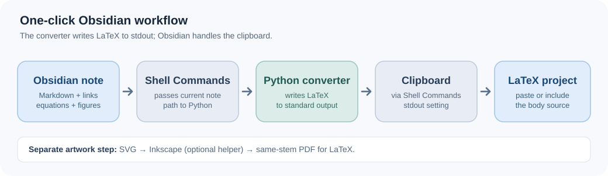
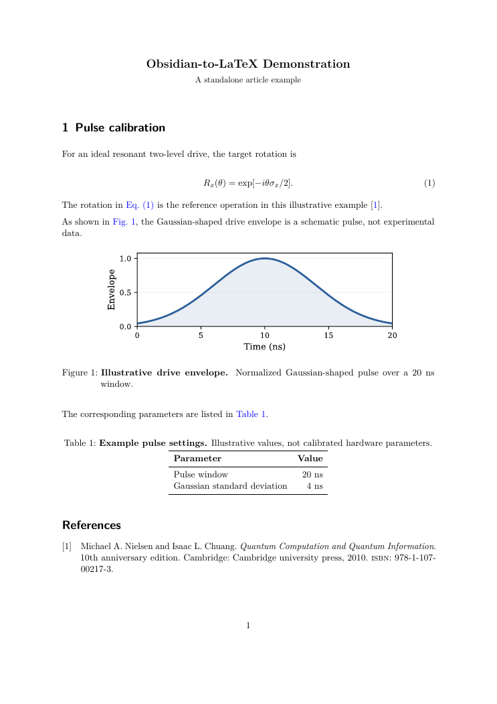
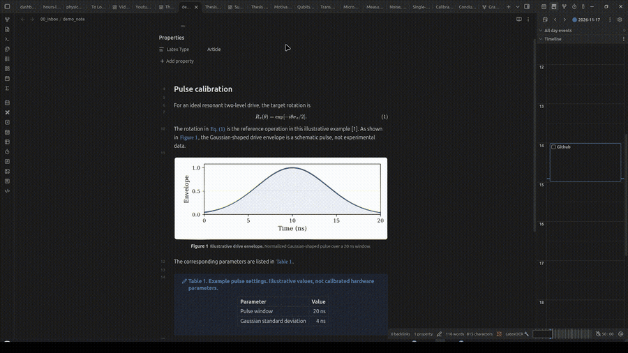

# Obsidian Markdown to LaTeX

Convert structured Obsidian notes into LaTeX source for theses, papers, and other academic writing. The converter is a standalone Python script: it does not require Pandoc, a particular LaTeX editor, or a custom Obsidian plugin. An optional Notion-to-Obsidian adapter also allows pages exported from Notion to use the same LaTeX conversion workflow.



**One-click use:** open a note in Obsidian, run a Shell Commands action, and paste the generated LaTeX into your document. **Command-line use:** run the same script on a Markdown file. The script prints the converted LaTeX to standard output; the Obsidian command is what copies it to the clipboard.

The project was developed for a physics thesis and supports both thesis chapters/sections and LaTeX article bodies. It is shared **as-is** as a reference implementation. Forks are welcome; regular maintenance, support, and upstream merges are not planned.

## What it converts

- Display equations with `\tag{...}` and local or cross-note equation references.
- Obsidian heading wikilinks, including ranges such as `Sections 2.3.4–2.3.6`, using live LaTeX section numbers rather than typed aliases.
- Figure embeds with captions, labels, first-reference placement, and native-size inclusion. Oversized figures are downscaled only if necessary to fit the text width or the caption-aware page-height budget.
- Markdown table callouts, including long tables and selected placement/column options.
- Citation keys such as `[@exampleKey]`, converted to LaTeX `\cite{exampleKey}` commands.
- Notes marked as chapters, sections, or article bodies via Obsidian YAML properties.

It does **not** compile LaTeX, create bibliography entries, or generate the images referenced by notes.

## See a conversion

**Obsidian Markdown input:**

```markdown
---
Latex Type: Article
---
## Pulse calibration
The drive implements
$$
R_x(\theta)=\exp[-i\theta\sigma_x/2].\tag{1}
$$
See $\ref{eq:1}$ for the rotation model.
```

**Generated LaTeX body:**

```latex
\phantomsection\label{doc:dee}

\section{Pulse calibration}
\label{sec:dee_pulse-calibration}
The drive implements

\begin{equation}
    R_x(\theta)=\exp[-i\theta\sigma_x/2].
    \label{eq:dee_1}
\end{equation}

See \hyperref[eq:dee_1]{Eq.~(\ref*{eq:dee_1})} for the rotation model.
```

The corresponding files are [`examples/demo_note.md`](examples/demo_note.md) and [`examples/demo_output.tex`](examples/demo_output.tex). Their output was generated with the converter, not manually transcribed.

For a complete compileable example, see **[`demo/`](demo/)**. It contains the Markdown note, generated chapter body, `scrartcl` master file, Zotero `.bib` entry, SVG and exported PDF under `Chapters/Figures/`, and a VS Code LaTeX Workshop recipe writing artifacts to `build/`. The PDF output is illustrated below.





The diagram above is included in the repository. A demonstration GIF can be added to `assets/` after recording an actual Obsidian-to-VS-Code session. See [VISUAL_ASSETS.md](VISUAL_ASSETS.md) for the recording plan.


## Notion to Obsidian (optional)

Notion pages can also be used with the existing LaTeX converter. Export a page as **Markdown & CSV** and run the separate [`notion_to_obsidian.py`](notion_to_obsidian.py) adapter. It converts native equation blocks, images and captions, captioned simple tables, numbered references, and page links into the Obsidian conventions understood by the main converter.


The adapter accepts Notion's original ZIP filename and extracts it internally. No separate launcher or citation map is required.

```bash
python3 notion_to_obsidian.py 'original-notion-export.zip' --strict
```

The output is written to `notion-converted/`, including the converted Markdown notes and image assets in `Chapters/Figures/`.

For bibliography citations, the adapter can retrieve citation keys from a running **Zotero instance with Better BibTeX**, or use an existing Zotero-exported bibliography:

```bash
python3 notion_to_obsidian.py 'original-notion-export.zip' --bib '/path/to/MAIN.bib' --strict
```

Unresolved citations generate warnings rather than fabricated keys.

See [NOTION_SETUP.md](NOTION_SETUP.md) for setup instructions, supported content, and limitations. The original Obsidian-to-LaTeX converter remains unchanged.


## Install and use

**Conversion only:** Python 3.10+ and the converter script. No third-party Python packages are required.

```bash
python md_to_latex_clipboard.py "path/to/Example Note.md" --root "path/to/vault" --strict > converted-note.tex
```

- `--root` lets the converter index linked notes, headings, and numbered objects throughout the chosen folder. Without it, only the source note's directory is indexed.
- `--strict` prevents converted LaTeX from being printed when there are conversion warnings.
- The generated file contains **body content**, not a standalone `\documentclass` or `\begin{document}`. Include it in your own LaTeX project or paste it into a suitable `.tex` file.

**One-click Obsidian integration:** install the community **Shell Commands** plugin and configure its command to pass the active note path, copy stdout to the clipboard, and show stderr as a notification. See **[OBSIDIAN_SETUP.md](OBSIDIAN_SETUP.md)** for the actual command, setup instructions, and the academic-writing plugin workflow.

### Academic authoring stack

Bibliographies, citation keys, and equation references are ordinary needs in STEM writing, even though no particular Obsidian plugin is required to produce the converter's output. A useful setup is:

| Tool | Role in a realistic writing workflow | Needed by the Python converter? |
| --- | --- | --- |
| **Equation Citator** | Author and navigate equation/figure references in Obsidian; compatible source formats are supported | No |
| **Zotero**, typically with **Better BibTeX** | Manage references and stable citation keys; export a `.bib` file for LaTeX | No |
| **Pandoc**, Obsidian Pandoc, and Pandoc Reference List | Alternative export paths and citation/reference previews while writing | No |
| **Shell Commands** | Launch the converter on the active Obsidian note and copy output to the clipboard | Only for the documented one-click workflow |
| **Inkscape** | Export same-stem PDFs from SVG figures before compiling LaTeX | Only for the separate SVG helper |

These are **recommended authoring tools**, not bundled or automatically installed dependencies. Zotero and Pandoc perform separate tasks: the converter does not run either one, and citation keys still need matching entries in the LaTeX bibliography. A LaTeX distribution is required when compiling the output, not when merely converting Markdown.

## Note conventions

A **chapter** note:

```markdown
---
Latex Type: Chapter
---
## 1) Background
### 1.1) Details
```

A **section within a chapter**:

```markdown
---
Latex Type: Section
Latex Parent: Theory
---
## 1) Driven-Qubit Dynamics
```

An **article body**:

```markdown
---
Latex Type: Article
---
## Introduction
### Experimental method
## Results
```

LaTeX manages the final heading numbers. For cross-note references, linked notes must be inside the indexed root and must have consistent titles and properties.

### References

```markdown
According to $\ref{eq:1}$, ...
Eq. (3) of [[Other Note]]
[[Microwave Control of Transmons#4) Coherent Leakage from Higher Transmon Levels|Sections 2.3.4]]–[[Microwave Control of Transmons#6) Finite-Anharmonicity Correction to the Pulse-Area Relation|2.3.6]]
```

In section-range links, the `|...` aliases are for Obsidian's display. The target note and heading, not the displayed numbers, determine the LaTeX references. The corresponding note and heading must exist in the index.

### Figures

```markdown
The pulse shapes are shown in $\ref{fig:1}$.

![[pulses.svg|center|fig:1|desc:**Pulse envelopes.** Time- and frequency-domain comparison.|700]]
```

The converter references `pulses.pdf` in the LaTeX it prints, but **does not create that PDF**. SVGs need to be exported separately before compiling under `pdflatex`. PNG, JPEG, and already-PDF artwork retain their corresponding file types.

The figure's **natural physical size is used when it fits**. The converter only reduces oversized figures to stay within the usable text width and the page-height budget after measuring the caption. Avoid upscaling small figures in the converter; prepare plots at their intended print size instead. `700` is an Obsidian display-width hint and is ignored for LaTeX sizing. No extra sizing directive is needed.

Default placement moves a figure after the paragraph containing its first local reference and requests top-of-page placement using `[!t]`. `|place:top` preserves the source position while also requesting `[!t]`; `|place:near` allows more float positions; `|place:section` and `|place:here` use anchored `[H]` placement. `|span:both` is available for wide figures. LaTeX controls the final page position: use `flafter` in your document preamble if you need to prevent top floats appearing above the chapter heading.

The default figure path is `Chapters/Figures` in Chapter, Section, and Article modes, relative to the compiled main `.tex` file. Use `--figure-dir` only when your LaTeX project deliberately stores images elsewhere.

**Optional SVG-to-PDF batch export:** `svg_to_pdf_batch.py` requires Inkscape and saves vector PDFs next to the original SVGs.

```bash
python svg_to_pdf_batch.py "path/to/vault/Chapters/Figures"
python svg_to_pdf_batch.py "path/to/vault/Chapters/Figures" --dry-run
```

It locates `Chapters/Figures` automatically if no directory is supplied, and skips up-to-date PDFs unless `--force` is used.

### Tables

```markdown
> [!table: 1] Table 1. **Calibration resources.** Circuit counts.
> | Method | Circuits |
> | --- | ---: |
> | RPE | 5 |
```

For special table placement and column layout, the converter also supports hidden directives such as `<!-- latex: place:top span:both width:fit cols:lXr -->`. The `width:fit` option requires `tabularx`. Long-table callouts use `longtable`.

## LaTeX integration

Use any compatible LaTeX document class and editor. A typical preamble for the relevant features is:

```latex
\usepackage{amsmath,amssymb}
\usepackage{graphicx,caption,hyperref}
\usepackage{float}      % [H] placement
\usepackage{placeins}   % \FloatBarrier where needed
\usepackage{booktabs}   % tables
\usepackage{longtable}  % long tables, if used
\usepackage{tabularx}   % width:fit tables, if used
```

Individual notes may use additional macros or packages (for example, `braket` for `\ket{...}`). For citations, include an appropriate BibTeX or `biblatex`/Biber setup and bibliography database. The converter does not choose a citation style or manage that database.

VS Code and `pdflatex` were used in the original writing workflow. The standalone **`demo/`** project includes an example VS Code LaTeX Workshop configuration, but the Python converter does not depend on VS Code. Another editor or LaTeX engine can be used subject to its usual package and figure-format compatibility. Journal templates and two-column figures may need template-specific validation.

## CLI options

Run `python md_to_latex_clipboard.py --help` to see all options.

| Option | Function |
| --- | --- |
| `--root PATH` | Folder to index for cross-note references |
| `--figure-dir PATH` | Figure directory path emitted in LaTeX |
| `--figure-placement MODE` | `first` (default), `top`, `near`, `section`, `here` |
| `--table-placement MODE` | `auto` (default), `top`, `near`, `section`, `here` |
| `--strict` | Exit without LaTeX output if conversion warnings occur |
| `--no-warnings` | Suppress warnings outside strict mode |

## Regression tests for forks

[`test_converter.py`](test_converter.py) is **included in the repository**, so forkers can run it before and after modifying the converter. It uses Python's standard-library `unittest` and self-contained temporary fixtures, not the author's private thesis files.

```bash
python -m unittest -v test_converter.py
```

The current suite contains **46 tests** for note modes, equations, references, section ranges, tables, caption handling, figure placement, native-size image behavior, and SVG export. Some tests compile small LaTeX documents or inspect generated PDFs. To run **all** tests, install `pdflatex`, `pdftotext`, Inkscape, and the optional Python package in `requirements-dev.txt`:

```bash
python -m pip install -r requirements-dev.txt
```

`unittest` reports **skips** if some external test tools are missing. A passing run with skipped tests is not equivalent to all checks executing; look at the run summary. No tests require Zotero, Pandoc, Obsidian, or access to private note files.

## Repository files

| File | Purpose |
| --- | --- |
| [`md_to_latex_clipboard.py`](md_to_latex_clipboard.py) | Converter; standard-library Python only |
| [`test_converter.py`](test_converter.py) | Regression suite for modifications and forks |
| [`svg_to_pdf_batch.py`](svg_to_pdf_batch.py) | Independent optional Inkscape exporter |
| [`OBSIDIAN_SETUP.md`](OBSIDIAN_SETUP.md) | One-click Obsidian configuration and academic authoring tools |
| [`assets/workflow.svg`](assets/workflow.svg) | Ready-to-use workflow diagram shown above |
| [`demo/`](demo/) | Self-contained standalone LaTeX article demonstration and example VS Code settings |
| [`assets/compiled-example.png`](assets/compiled-example.png) | Screenshot of the verified demo output |
| [`requirements-dev.txt`](requirements-dev.txt) | Optional PDF-inspection dependency for the full regression suite |
| [`examples/`](examples/) | A small, non-private conversion demonstration |
| [`notion_to_obsidian.py`](notion_to_obsidian.py) | Optional Notion export adapter |
| [`test_notion_to_obsidian.py`](test_notion_to_obsidian.py) | Regression tests for Notion conversion |
| [`NOTION_SETUP.md`](NOTION_SETUP.md) | Notion export, citation matching, and conversion instructions |

## Limitations, forks, and license

This is an **Obsidian-oriented** Markdown converter, not a full Markdown or Pandoc implementation. The supported syntax reflects the original academic workflow. Other Markdown extensions, plugins, complex LaTeX macros, or publication templates may require adjustments. Always compile the full LaTeX project and check warnings, layout, and references after converting.

The project is published as-is, without a commitment to merge pull requests or maintain downstream forks. Users are welcome to fork the repository and maintain their own changes. Do not upload a private vault, `.obsidian` or `.pandoc` data folders, plugin caches, or personal machine paths to a public repository.

This project is shared as a stable, independently usable tool. Active development and regular maintenance are not planned, but bug reports, discussions, and contributions are welcome.

Licensed under the **MIT License**, see [LICENSE](LICENSE). **Before publishing**, replace the copyright placeholder in that file with the chosen author or GitHub username.
