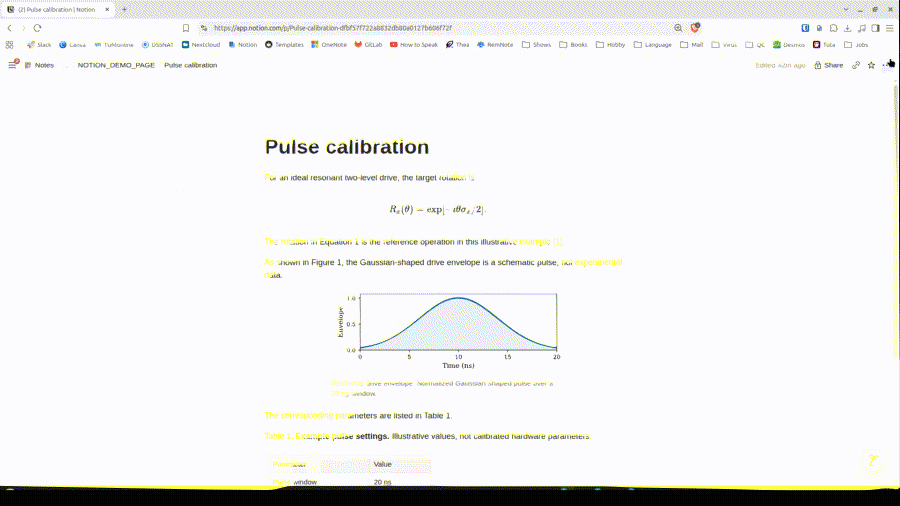

# Obsidian Markdown to LaTeX

**Write scientific documents in Obsidian. Typeset them with LaTeX.**

Convert structured Obsidian notes into editable LaTeX source for theses, papers, and other technical documents. Write mathematics, figures, citations, and cross-references in Markdown while retaining control of your LaTeX document class, bibliography, and build process.


The converter is a standalone Python script. It does **not** require Pandoc, a particular LaTeX editor, or a custom Obsidian plugin. It produces a LaTeX **body fragment**, not a compiled PDF or a complete document. The included [`demo/`](demo/) shows how to use that output in a local LaTeX project.

Developed for a physics thesis, this project is shared as a stable, as-is tool for STEM students and researchers. Regular development and maintenance are not planned. Potential extensions are recorded in [Possible future directions](PLUGIN_ROADMAP.md), not announced as upcoming releases.

## Why use it?

- **Keep scientific writing in Obsidian.** Use notes, rendered mathematics, and wikilinks without authoring the entire manuscript in raw LaTeX.
- **Retain LaTeX control.** Export editable source that can be included in an existing university or journal template.
- **Preserve structured references.** Generate LaTeX labels and links from supported Obsidian equation, figure, table, and heading conventions.
- **Build locally.** Use your preferred LaTeX toolchain without depending on a hosted editor or a subscription service.

## Supported conversion

The main converter handles:

- Display equations, including `\tag{...}`, numbered and unnumbered output, and local or cross-note equation references.
- Headings and Obsidian wikilinks, including cross-note headings and ranges whose numbers are resolved by LaTeX rather than hard-coded in link aliases.
- Figure embeds with captions, labels, placement options, first-reference placement, and preservation of natural image size when it fits the available space.
- Numbered Markdown table callouts, including selected float and column options, wide tables, and long tables.
- Bibliography citation keys such as `[@exampleKey]` or `[@firstKey; @secondKey]`, converted to `\cite{...}`.
- Notes identified through `Latex Type: Chapter`, `Section`, or `Article` in their frontmatter.

The converter does **not** compile LaTeX, create `.bib` entries, produce images, or provide a general-purpose implementation of every Markdown extension. Its syntax is designed around a broad scientific-writing workflow, but other plugins and publication templates may require adjustments.

## See a conversion

**Obsidian Markdown input:**

```markdown
---
Latex Type: Article
---
## Pulse calibration
The drive implements
$$
R_x(\theta)=\exp[-i\theta\sigma_x/2].\tag{1}
$$
See $\ref{eq:1}$ for the rotation model.
```

**Generated LaTeX body:**

```latex
\phantomsection\label{doc:dee}

\section{Pulse calibration}
\label{sec:dee_pulse-calibration}
The drive implements

\begin{equation}
    R_x(\theta)=\exp[-i\theta\sigma_x/2].
    \label{eq:dee_1}
\end{equation}

See \hyperref[eq:dee_1]{Eq.~(\ref*{eq:dee_1})} for the rotation model.
```

These examples correspond to [`examples/demo_note.md`](examples/demo_note.md) and [`examples/demo_output.tex`](examples/demo_output.tex).

For an end-to-end demonstration, [`demo/`](demo/) includes a Markdown source note, its generated LaTeX article body, a `scrartcl` master file, bibliography, SVG and PDF figure, and a VS Code LaTeX Workshop configuration. The compiled result is shown below.


The workflow GIF at the top of this README is already included in the repository. The converter, SVG exporter, and LaTeX compiler remain separate tools throughout the demonstration.

## Install and use

**Conversion requires Python 3.10+ and [`md_to_latex_clipboard.py`](md_to_latex_clipboard.py).** The converter uses only Python's standard library.

Run it from a terminal:

```bash
python md_to_latex_clipboard.py "path/to/Example Note.md" --root "path/to/vault" --strict > converted-note.tex
```

The script writes LaTeX to standard output. `--root` scans the specified folder for relevant notes and cross-note references; without it, the source file's directory is used. `--strict` prevents LaTeX from being printed if conversion warnings occur. Include the resulting fragment in your LaTeX project, or copy it into the appropriate `.tex` file.

### One-command use in Obsidian

The existing workflow uses the community [Shell Commands](https://github.com/Taitava/obsidian-shellcommands) plugin. Configure a command to run the converter with the active note's path, send **stdout to Clipboard**, and display **stderr as a Notification**. The command can then be launched from Obsidian's command palette.

The exact configuration, including an example command and path handling, is in [OBSIDIAN_SETUP.md](OBSIDIAN_SETUP.md). Shell Commands is required only for this particular Obsidian integration, not for command-line conversion. There is **no native Obsidian plugin for this converter** in the repository or Community Plugins directory at present.

### Companion tools

| Tool | Purpose | Required for Python conversion? |
| --- | --- | --- |
| Equation Citator | Helps author and navigate supported equation and figure references inside Obsidian | No |
| Zotero + Better BibTeX | Maintains citation keys and exports bibliography files | No |
| Pandoc and related Obsidian plugins | Offer alternative export or reference-preview workflows | No |
| Shell Commands | Launches the converter and copies its output in the documented one-command workflow | No, except for that integration |
| Inkscape | Converts SVG artwork to PDF through the separate helper | No |

These tools are not installed or invoked by the Python converter. A LaTeX distribution is needed to **compile** the generated source, not to convert Markdown.

## Note conventions

The converter uses simple frontmatter properties to determine the LaTeX hierarchy. The note filename supplies the top-level heading for a chapter or section, so notes normally begin their internal headings at `##`.

**Chapter:**

```markdown
---
Latex Type: Chapter
---
## 1) Background
### 1.1) Details
```

**Section of a chapter:**

```markdown
---
Latex Type: Section
Latex Parent: Theory
---
## 1) Driven-Qubit Dynamics
```

**Article body:**

```markdown
---
Latex Type: Article
---
## Introduction
### Experimental method
## Results
```

In Article mode, the converter adds no visible document-title wrapper, leaving the master LaTeX file responsible for its title and front matter. LaTeX manages the final section numbering in all modes. Linked notes must be discoverable under the indexed root and have consistent names and document properties.

### Equations and references

```markdown
According to $\ref{eq:1}$, ...
Eq. (3) of [[Other Note]]
[[Microwave Control of Transmons#4) Coherent Leakage from Higher Transmon Levels|Sections 2.3.4]]–[[Microwave Control of Transmons#6) Finite-Anharmonicity Correction to the Pulse-Area Relation|2.3.6]]
```

For heading links, the target note and heading, not the text after `|`, determine the generated LaTeX reference. Thus, the section numbers remain those of the compiled document. Local `\tag{...}` identifiers and figure/table tags must be unique within their relevant note namespace. Unresolved or duplicate references can generate warnings; use `--strict` when verifying a conversion.

### Figures

```markdown
The pulse shapes are shown in $\ref{fig:1}$.

![[pulses.svg|center|fig:1|desc:**Pulse envelopes.** Time- and frequency-domain comparison.|700]]
```

For an SVG embed, the generated LaTeX refers to a same-stem PDF (`pulses.pdf`). **The converter does not create this PDF.** PNG, JPEG, and existing PDF artwork retain their file types. The Obsidian display-width hint (`700` above) does not determine LaTeX print size.

Figures keep their natural size if they fit; oversized artwork is reduced to the available line width or the height remaining after accounting for the caption. The default `first` placement relocates a standalone figure after the paragraph containing its first local reference, while requesting top-of-page floating. `|place:top`, `|place:near`, `|place:section`, and `|place:here` provide other behaviors. `|span:both` supports wide figures in appropriate two-column documents. The final position remains subject to LaTeX float rules.

By default, generated paths point to `Chapters/Figures` relative to the **main LaTeX document**. Use `--figure-dir` for another project layout.

To export SVG artwork separately, use [`svg_to_pdf_batch.py`](svg_to_pdf_batch.py) with Inkscape:

```bash
python svg_to_pdf_batch.py "path/to/vault/Chapters/Figures"
python svg_to_pdf_batch.py "path/to/vault/Chapters/Figures" --dry-run
```

The helper can locate `Chapters/Figures` automatically in supported layouts and skips PDFs that are already up to date unless `--force` is used.

### Tables

```markdown
> [!table: 1] Table 1. **Calibration resources.** Circuit counts.
> | Method | Circuits |
> | --- | ---: |
> | RPE | 5 |
```

The converter generates numbered LaTeX tables and supports long-table callouts. Additional options can be supplied with comments such as `<!-- latex: place:top span:both width:fit cols:lXr -->` in the appropriate table callout. `width:fit` uses `tabularx`, while long tables use `longtable`. See the converter examples and tests for the supported combinations.

## From Notion (optional)

[`notion_to_obsidian.py`](notion_to_obsidian.py) is a **separate, implemented adapter**, not a replacement for the main converter. It reads Notion **Markdown & CSV** exports and produces Markdown that follows the Obsidian conventions above.



```bash
python3 notion_to_obsidian.py 'original-notion-export.zip' --strict
```

The adapter accepts a ZIP without manual extraction and writes converted notes plus local image assets to `notion-converted/` by default. Supported normalization includes equation blocks, local figures and captions, captioned simple tables, selected numerical references, and links between exported pages.

For DOI-linked numbered citations, it can resolve actual Better BibTeX keys from a running Zotero instance or a supplied `.bib` file:

```bash
python3 notion_to_obsidian.py 'original-notion-export.zip' --bib '/path/to/MAIN.bib' --strict
```

Unverified keys are not invented by default; unresolved citations produce warnings. The adapter has its own regression tests and does not use a live Notion API. See [NOTION_SETUP.md](NOTION_SETUP.md) for supported cases, reference conventions, and limitations.

## LaTeX integration

Use the generated body with your own LaTeX class and template. A typical preamble for the relevant features is:

```latex
\usepackage{amsmath,amssymb}
\usepackage{graphicx,caption,hyperref}
\usepackage{float}      % anchored [H] placement
\usepackage{placeins}   % \FloatBarrier
\usepackage{booktabs}   % tables
\usepackage{longtable}  % long tables, if used
\usepackage{tabularx}   % width:fit tables, if used
```

Your notes may require other packages or macros, such as `braket` for `\ket{...}`. Citation commands need a matching BibTeX or `biblatex` bibliography, which remains your responsibility. VS Code and `pdflatex` are used in the demonstration, not required by the converter itself. Compile the full project and review its warnings, layout, and references after conversion.

## Command-line options

Run `python md_to_latex_clipboard.py --help` for the complete interface.

| Option | Effect |
| --- | --- |
| `--root PATH` | Folder to index for cross-note references |
| `--figure-dir PATH` | Figure path emitted in LaTeX |
| `--figure-placement MODE` | `first` (default), `top`, `near`, `section`, `here` |
| `--table-placement MODE` | `auto` (default), `top`, `near`, `section`, `here` |
| `--strict` | Exit without LaTeX output if warnings are generated |
| `--no-warnings` | Suppress warning messages outside strict mode |

## Tests and examples

The repository includes **46 converter regression tests** in [`test_converter.py`](test_converter.py) and **16 Notion-adapter regression tests** in [`test_notion_to_obsidian.py`](test_notion_to_obsidian.py). They use self-contained fixtures rather than private thesis files.

```bash
python -m unittest -v test_converter.py
python -m unittest -v test_notion_to_obsidian.py
```

Some converter tests invoke `pdflatex`, `pdftotext`, or Inkscape or inspect PDFs through the optional dependency listed in [`requirements-dev.txt`](requirements-dev.txt). Install the necessary external tools and `python -m pip install -r requirements-dev.txt` to exercise those checks. `unittest` may otherwise report skips; a passing run with skipped tests does not establish that every check executed. The tests are provided for regression checking and are not a claim that every environment and publication template has been validated.

The most relevant entry points are:

| Path | Purpose |
| --- | --- |
| [`md_to_latex_clipboard.py`](md_to_latex_clipboard.py) | Main Markdown-to-LaTeX converter |
| [`notion_to_obsidian.py`](notion_to_obsidian.py) | Optional Notion-export normalization |
| [`svg_to_pdf_batch.py`](svg_to_pdf_batch.py) | Optional Inkscape SVG-to-PDF helper |
| [`OBSIDIAN_SETUP.md`](OBSIDIAN_SETUP.md) | One-command integration instructions |
| [`NOTION_SETUP.md`](NOTION_SETUP.md) | Adapter conventions and setup |
| [`demo/`](demo/) and [`examples/`](examples/) | Standalone and minimal conversion examples |
| [`PLUGIN_ROADMAP.md`](PLUGIN_ROADMAP.md) | Possibilities if development resumes |

## Scope, maintenance, and license

The converter supports the conventions used in its academic writing workflow, rather than every Markdown flavor, Obsidian plugin, LaTeX macro, or journal template. Its label scheme and cross-note references assume consistent filenames, headings, and properties. The generated source should be checked in the context of the intended LaTeX document.

The code is shared **as-is**, without a development schedule or commitment to future features, regular support, or maintenance. Bug reports, discussions, and contributions are welcome, and the project can be forked under its [MIT License](LICENSE). A separate roadmap records possibilities rather than promised releases.

Do not publish private vault contents, `.obsidian` or `.pandoc` configuration directories, cached bibliography data, or local machine paths when sharing a reproduction or fork.
